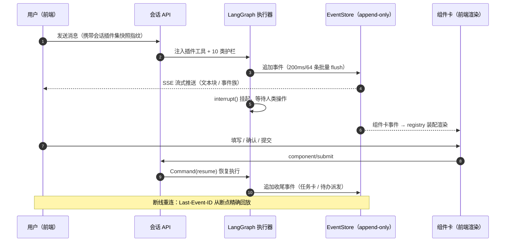

<div align="center">


# XinHere · 信在此，新在此

**对话式业务组件平台（Conversational Business Component Platform）**

*用一句话发起业务，用一张卡片完成协作。*

[](https://www.python.org/)
[](https://fastapi.tiangolo.com/)
[](https://langchain-ai.github.io/langgraph/)
[](https://github.com/langchain-ai/deepagents)
[](https://react.dev/)
[](https://www.typescriptlang.org/)
[](https://vitejs.dev/)
[](https://tailwindcss.com/)
[](https://www.postgresql.org/)
[](#-测试与质量)

</div>

---

## 目录导航

[✨ 为什么是 XinHere](#-为什么是-xinhere) · [🏗️ 架构总览](#️-架构总览) · [💬 对话主链路](#-对话主链路事件溯源--人机协同) · [🧩 插件体系](#-插件体系) · [📐 工程方法论](#-工程方法论) · [🛡️ 生产可靠性](#️-生产可靠性) · [🖥️ 三模式层](#️-三模式层) · [🚀 快速开始](#-快速开始) · [🧪 测试与质量](#-测试与质量) · [🔗 玄圃集成](#-玄圃集成) · [📦 数据模型](#-数据模型) · [🛠️ 技术栈](#️-技术栈)

---

## ✨ 为什么是 XinHere

XinHere 面向投资集团总部 ↔ 被投企业 的投后管理协作场景：**用户在聊天窗口用自然语言提出业务需求，模型输出文字 + 结构化事件，前端用预设业务组件渲染**（风险填报、资金保障、KPI 考核、投后报告等）；组件交互本身成为对话上下文记忆，可基于填报内容继续派发后续任务。

| # | 亮点 | 一句话说明 |
|---|------|-----------|
| 1 | **组件卡即协作** | LLM 通过 `interrupt()` 挂起对话等待人类操作，前端渲染可交互组件卡，用户提交后 `Command(resume)` 恢复执行 —— 真正的人机协同（HITL）闭环 |
| 2 | **事件溯源会话** | append-only 事件日志（`(session_id, seq)` 连续），SSE 断线用 `Last-Event-ID` 精确回放，服务崩溃可恢复、可审计 |
| 3 | **契约优先** | 10 份 JSON Schema 是前后端唯一事实源，脚本双端生成 pydantic 模型 + TS 类型，`--check` 模式可接入 CI 防手改 |
| 4 | **三红线治理** | 逻辑删除 / 审计四件套 / 全量操作留痕，全部由 SQLAlchemy ORM 事件钩子实现，业务代码零侵入 |
| 5 | **插件化业务** | 4 个业务插件（风险填报 / KPI 考核 / 投后报告 / OA 工作流）自带模型、服务、组件，「插件三问」SOP 保证一致质量 |
| 6 | **DeepSeek Harness 血统** | 借鉴其「一切皆插件、append-only 事件日志、事件族驱动组件渲染」架构思想，轻量自研实现 |
| 7 | **生产级可靠性** | 崩溃自动恢复、会话执行互斥 + 后台守护 DB 租约、SSE 背压丢最旧保最新、Fail-Fast 配置矩阵、Host 围栏 |
| 8 | **三模式层体验** | Xin语（AI 对话）/ Xin台（AI 能力执行）/ 青山知识库（水墨山水第三页面），开屏双门 + 液态水面交互动效 |
| 9 | **真 AI 能力落地** | 会议纪要发言人声纹识别（CAM++ ONNX 本地推理）、行研报告技能（HTML/PDF 成对交付）、Excel 信息填报解析 |
| 10 | **契约化测试矩阵** | 9 个后端单测模块 + 13 个 E2E 场景，E2E 走 nginx 全链路并用 psycopg 直连数据库对账 |
| 11 | **一键发布哲学** | 改代码/改配置不重建镜像（全卷挂载），仅依赖变化才 rebuild；发布即自动幂等迁移 |

## 🏗️ 架构总览

XinHere 是**目录约定式 monorepo**（不依赖 pnpm/turbo workspace，目录即契约），前后端通过 `packages/contracts` 生成的类型强约束通信：

```mermaid
flowchart TB
    subgraph FE["apps/frontend · React 19 壳"]
        SHELL["shell<br/>SplashGate 开屏 / Frame 框架<br/>TaskList 历史 / CockpitHome Xin台"]
        SCMS["scms · Xin台页面群"]
        REG["registry · 组件装配器"]
        TRANS["transport · SSE 客户端<br/>Last-Event-ID 回放"]
    end
    subgraph BE["apps/backend · FastAPI"]
        API["platform/api · REST 路由"]
        AGENT["platform/agent<br/>executor.py · LangGraph 执行器<br/>stream_bridge · event_translator<br/>component_handlers"]
        EVENTS["platform/events · EventStore<br/>append-only · 批量 flush"]
        PLUG["platform/plugins · 插件装载器<br/>fail-loud · 快照指纹"]
        AUDIT["platform/audit + persistence<br/>三红线 ORM 事件钩子"]
        SVC["services + modules<br/>业务服务层"]
    end
    subgraph PG[("PostgreSQL · xinhere 库<br/>46 张表 + LangGraph checkpoint")]
        DB((('')))
    end
    subgraph PLUGINS["plugins/ · 业务插件三件套"]
        P1["risk-warning"]
        P2["kpi-assessment"]
        P3["post-investment"]
        P4["oa-workflow"]
    end
    CONTRACTS["packages/contracts<br/>10 JSON Schema → gen.py 双端生成"]

    SHELL --> TRANS -- "SSE / REST" --> API
    TRANS --> REG -- "渲染组件卡" --> SHELL
    API --> AGENT --> EVENTS
    AGENT --> PLUG
    API --> SVC
    PLUG -.-> PLUGINS
    PLUGINS -.-> SVC
    EVENTS --> DB
    AUDIT --> DB
    CONTRACTS -.->|pydantic| BE
    CONTRACTS -.->|TS interface| FE
```

## 💬 对话主链路：事件溯源 + 人机协同

从一句话到一张组件卡，再到任务收尾，全链路可回放、可恢复、可审计：




**关键设计**：

- **事件族驱动渲染**：后端只发结构化事件，前端 `ConversationAssembler` 负责把事件流装配成消息 + 组件卡，前后端彻底解耦；
- **HITL 挂起语义**：组件交互不是「弹窗打断」，而是 LangGraph 图的原生 `interrupt()` 状态 —— 刷新页面、断线重连、服务重启后都能恢复到挂起点继续；
- **插件快照指纹**：每个会话记录其可见插件集指纹，历史会话回放时组件行为与当时一致，插件升级不影响旧会话。

## 🧩 插件体系

业务能力全部插件化，每个插件自带数据模型、服务层、LLM 工具与前端组件：

| 插件 | 能力 | 前端组件 | LLM 工具 |
|------|------|---------|:---:|
| `risk-warning` | 风险填报 / 资金保障闭环 | 填报表单、汇总看板 | — |
| `kpi-assessment` | KPI 考核 / 里程碑 / 红绿灯调整 | 考核卡、指标表 | — |
| `post-investment` | 投后报告（PIT）/ 行研报告 | 报告卡、图表 | — |
| `oa-workflow` | OA 工作流对接 | 流程卡 | ✅ `agent_tools` 直连对话图 |

**插件三问 SOP**（新增插件前必答，保证质量一致）：

1. **数据从哪来？** —— 明确数据模型与写入路径，纳入三红线治理；
2. **事件怎么发？** —— 定义事件族与组件卡契约，schema 先行；
3. **用户怎么交互？** —— 组件卡交互 → `interrupt()`/`resume()` 全链路自洽，E2E 场景覆盖。

插件装载采用 **fail-loud** 策略：装配失败直接拒绝启动，绝不带病运行。

## 📐 工程方法论

<details open>
<summary><b>① 借鉴 DeepSeek Harness：一切皆插件 + 事件溯源</b></summary>

- **一切皆插件**：业务能力不写死在核心里，核心只提供「对话图 + 事件流 + 组件装配」三件套；
- **append-only 会话事件日志**：会话是事件流而非消息数组，天然支持回放、审计、断点恢复；
- **事件族驱动组件渲染**：前端不解析 LLM 原文，只消费结构化事件族。

</details>

<details open>
<summary><b>② 契约优先：10 份 JSON Schema 是唯一事实源</b></summary>

```bash
packages/contracts/
├── schemas/          # core / risk / cash / kpi / pit / meeting / task
│                     # / cockpit / dynamic_template / voiceprint —— 10 份
├── scripts/gen.py    # 双端代码生成（--check 模式可接入 CI）
└── generated/        # pydantic 模型（extra=forbid）+ TS interface
```

前后端类型不一致靠 `--check` 一步拦下，而不是等到生产环境的深夜。

</details>

<details open>
<summary><b>③ 三红线治理：业务零侵入</b></summary>

| 红线 | 实现 |
|------|------|
| 逻辑删除 | ORM 事件钩子自动改写 DELETE → 软删标记 |
| 审计四件套 | `created_by / created_at / updated_by / updated_at` 自动维护 |
| 全量操作留痕 | 所有写操作自动落审计日志，含数据快照 |

三条红线全部实现在 `app/persistence/session.py` 的 ORM 事件钩子中，业务代码一行不写。

</details>

## 🛡️ 生产可靠性

| 机制 | 说明 |
|------|------|
| **崩溃恢复** | 启动时 `recover_crashed()` 扫描中断会话，重建 checkpoint 状态，用户无感续跑 |
| **会话执行互斥** | 进程内执行器注册表保证同一会话同时只有一个执行器，重复请求返回 RUN_BUSY；多副本下后台守护任务另以 DB 租约互斥选主 |
| **SSE 背压** | 慢消费者丢最旧保最新，事件日志权威不变，重连后补齐 |
| **Fail-Fast 配置** | 启动即校验配置矩阵，缺配置拒绝启动（单测 `test_config_check.py` 专项覆盖） |
| **Host 围栏** | 出网域名白名单，LLM 工具调用无法触达围栏外主机 |
| **附件安全** | 对话附件解析覆盖 PDF/Word/PPT/Excel，生物特征数据审计自动脱敏（迁移 `0020`） |

## 🖥️ 三模式层

| 模式 | 定位 | 说明 |
|------|------|------|
| **Xin语** | AI 对话 | 对话式业务组件主战场，历史以「对话记录」呈现 |
| **Xin台** | AI 能力执行 | 驾驶舱（日·守）：智能体应用 / AI 促研 / AI 工具 / 业务系统分组卡片，全部服务端配置；历史以「执行记录」呈现 |
| **青山知识库** | 知识库平台 | 水墨青绿山水第三页面（iframe 内嵌外部 KB 平台，`KB_URL` 运行时配置） |

开屏即景：双门交叠 + 液态水面涟漪（`SplashGate`）—— 左门进入 Xin语，右门进入 Xin台，点击水下「青山」题字进入知识库。

## 🚀 快速开始

### 一键发布（推荐）

```bash
bash deploy/publish.sh
```

四步全自动：**构建前端 dist → 依赖指纹检测（仅依赖变化才重建镜像）→ alembic 幂等迁移 → 启动并重启前端**（重新渲染运行时配置）。

### 手动本地开发

```bash
# 后端（Python 3.12）
cd apps/backend
python -m venv .venv && source .venv/bin/activate
pip install -r requirements.txt
alembic upgrade head
uvicorn app.main:app --port 8196

# 前端（Node 18+）
cd apps/frontend
npm ci && npm run dev
```

### 核心配置

| 变量 | 说明 |
|------|------|
| `MAIN_API_URL` / `MAIN_MODEL` | OpenAI 兼容 LLM 端点与模型名 |
| `DATABASE_URL` | PostgreSQL 连接串（LangGraph checkpoint 同库） |
| `KB_MCP_URL` | 青山知识库 MCP 端点（可选） |
| `KB_URL` | 前端知识库 iframe 地址（可选） |
| `LANGFUSE_*` | LLM 观测（未配置不追踪） |
| `MINIO_*` | 对象存储（未配置回退本地磁盘） |
| `VOICEPRINT_ENABLED` | 会议声纹识别开关（`false` 时零开销） |
| `MCP_SERVER_ENABLED` | 开启后同进程挂载 `/mcp` streamable http 服务端（默认关） |

> 前端运行时配置经 `deploy/config.js.template` 渲染注入，改 `VITE_*` 后重启 frontend 容器即生效，无需重建镜像。

## 🧪 测试与质量

**单元测试**（`apps/backend/tests`，9 个模块）：事件存储并发、interrupt 语义不匹配、三红线治理、配置 Fail-Fast、种子数据幂等、SSO 代理、待办状态机、chunk 配对、基础服务。

**E2E 矩阵**（`tests/e2e`，13 场景，走 nginx 全链路 + psycopg 直连数据库对账）：

| # | 场景 | # | 场景 |
|---|------|---|------|
| 01 | 认证 / SSO | 08 | 待办动作 |
| 02 | 对话主链路 | 09 | 看板 |
| 03 | 风险派发 | 10 | SSE 断线重连 |
| 04 | 风险填报闭环 | 11 | 崩溃恢复 |
| 05 | 资金保障 | 12 | 三红线治理 |
| 06 | KPI 考核 | 13 | 知识库 |
| 07 | PIT 报告 | | |

```bash
cd apps/backend && pytest tests -x          # 单元测试
cd tests/e2e && pytest . -x                 # E2E（需 compose 环境在跑）
```

> E2E 默认基址为 `http://localhost:8095`（可用 `E2E_BASE_URL` 覆盖）；compose/nginx 部署侧对外端口为 8096，直跑 E2E 前请设置 `E2E_BASE_URL` 指向实际入口。

## 🔗 玄圃集成

XinHere 是 **[玄圃 XuanPu](../xuanpu/README.md)** 本体智能套件的对话式业务组件层：

- `app/platform/xuanpu/` + `xuanpu_perm.py`：对接玄圃 SSO 统一认证与五服务同源 HMAC Token 互认，权限随身份三元组贯通；
- 数据库迁移 `0003_sso_and_cockpit` 起即按玄圃身份体系建模；
- 两套系统共享「企业级可信 AI」理念：玄圃管**本体与治理**，XinHere 管**对话与组件落地**。

## 📦 数据模型

46 张表，21 个 Alembic 迁移（`0001` → `0021`）演进而来，按能力域分组：

| 能力域 | 内容 |
|--------|------|
| 身份与会话 | 用户、会话、消息、插件快照指纹、LangGraph checkpoint |
| 任务内核 | `task_kernel` 任务树（chat / exec / folder）、待办卡片、任务记录 |
| 业务插件 | 风险填报、资金保障、KPI 考核、投后/PIT 报告、OA 工作流 |
| 报告产出 | HTML 报告、PPT 报告、行研报告交付物 |
| 会议智能 | 会议纪要、发言人派发、声纹特征（审计自动脱敏） |
| 信息填报 | 动态模板（Excel 解析）、填报记录 |
| 平台治理 | 审计日志、SSO/驾驶舱配置、Xin台卡片、用户通知 |

数据库结构唯一迁移源为 Alembic；种子数据（`app/seed.py`）幂等，可重复执行。

## 🛠️ 技术栈

| 层 | 技术 |
|----|------|
| 前端 | React 19 · TypeScript 5.8 · Vite 6 · Zustand 5 · antd 6（React19 补丁）· Tailwind CSS 4 · mermaid · ECharts 6 · react-markdown |
| 后端 | Python 3.12 · FastAPI 0.141 · SQLAlchemy 2.0（psycopg 3）· LangGraph 1.2 · deepagents 0.7 · langgraph-checkpoint-postgres · alembic · sse-starlette |
| AI 能力 | OpenAI 兼容协议（可配端点/模型）· CAM++ 声纹 ONNX 本地推理（onnxruntime + kaldi-native-fbank）· fastmcp MCP 服务端（可选） |
| 文档处理 | PyMuPDF · weasyprint（HTML→PDF 成对交付）· python-pptx · python-docx · openpyxl / xlrd · pypdf |
| 存储 | PostgreSQL（业务 + checkpoint 同库）· MinIO 对象存储（可选，回退本地磁盘） |
| 观测 | Langfuse LLM 追踪（可选）· 审计全量留痕 |
| 部署 | Docker Compose · nginx · publish.sh 四步发布 · 运行时 config.js 注入 |

---

<div align="center">

**信在此 —— 消息即业务；新在此 —— 对话即系统。**

XinHere · 对话式业务组件平台

</div>
